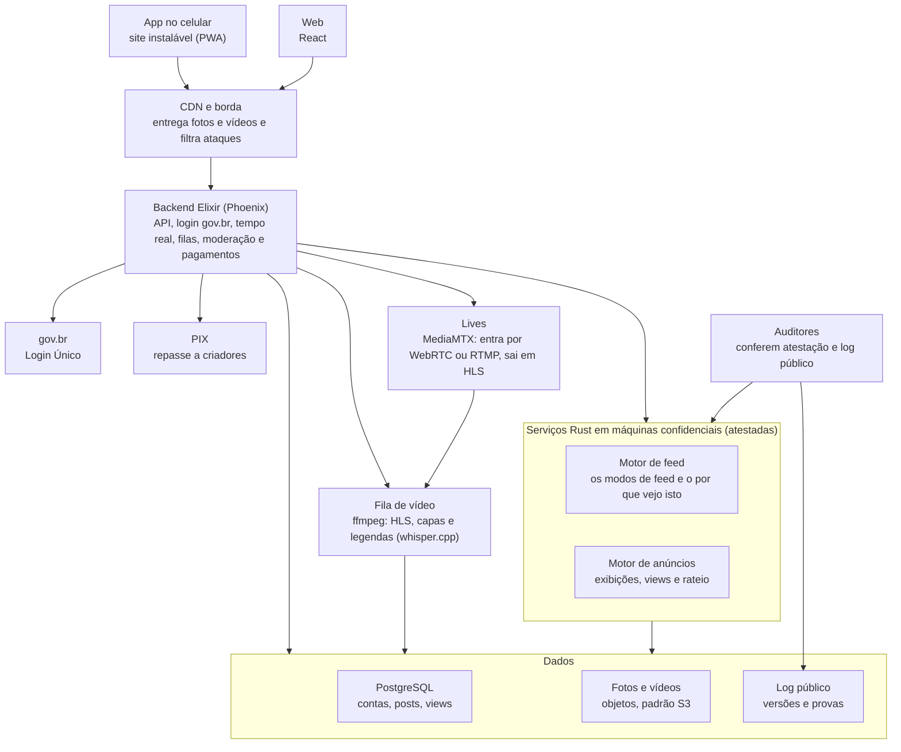

# Plano inicial -rede+social

Versão de 9 de outubro de 2026. Daqui em diante, mudanças nas regras descritas aqui passam por [RFC](rfcs/README.md).

A -rede+social é um exemplo de rede social pública, de código aberto e sem fins lucrativos. Ela não pretende ser a rede social do país. O objetivo é mostrar, com código que funciona, como uma rede assim poderia ser, e deixar tudo aberto para que alguém com estrutura e orçamento faça uma de verdade, com este código ou só com as ideias.

Por isso o plano descreve duas coisas: o que o exemplo já mostra funcionando e o que uma rede de verdade ainda precisaria para receber gente. Ele cobre produto, dinheiro, algoritmos, arquitetura, segurança e governança. No desenho, quem paga a estrutura é um investidor que não busca lucro, de preferência do setor público (o porquê está no princípio 1). O texto para o público está no [manifesto](../MANIFESTO.md).

## Onde estamos

Existe uma demonstração que roda inteira no computador com um comando e mostra as ideias centrais funcionando: login pelo gov.br (simulado na demo, pronto para homologação), publicação, feed por grafo com o "por que estou vendo isto", moderação com recurso, o cofre do CPF com os guardiões, anúncios com pagamento por faixas e a página de transparência. Tudo com pessoas, anunciantes e valores fictícios. Nada está em produção e nenhuma pessoa real usou a rede ainda.

A demonstração foi construída na frente das fases, tocando partes da 1 à 4, porque era preciso mostrar a proposta funcionando. Isso não pula nenhum portão. O que falta em cada fase é justamente o que transforma a demonstração em algo que pode receber gente de verdade. As fases 1 a 4 podem avançar aqui, no repositório. A 5 depende de alguém decidir levar a ideia adiante.

| Fase | Situação |
| --- | --- |
| 0 · Manifesto e comunidade | Quase pronta. Faltam contribuidores de fora e o conselho provisório |
| 1 · Protótipo | Pronta na demo, com o gov.br de homologação já integrado. Faltam as credenciais do gov.br, uma fonte confiável de idade e o grupo de teste |
| 2 · Algoritmos e transparência | Feed conferível de ponta a ponta: registro público, recibo assinado, retratos do grafo, verificador aberto e build reproduzível. Faltam escala, gRPC e alguém de fora fazer o caminho todo |
| 3 · Vídeo | Vídeo em HLS, envio que retoma, legendas automáticas, lives e custo por hora medido. Faltam o orçamento que fecha o portão e uma CDN de verdade |
| 4 · Anúncios e pagamentos | Compra de campanha com PIX, entrega no ritmo do dia, fechamento do mês pelo motor, extrato conferível e repasse por PIX. Faltam o banco de verdade, a auditoria externa e a revisão jurídica |
| 5 · Piloto | Depende de alguém levar a ideia adiante |

O detalhe de cada fase está na [seção 11](#11-roadmap-e-situação-atual).

## 1. Princípios

Toda decisão de produto, código ou negócio precisa respeitar estas seis regras. Se uma proposta quebra alguma, ela não entra.

1. **Pública e sem dono.** Quem paga a infraestrutura é um investidor que não busca lucro, de preferência do setor público, e talvez só ele. Quem investe esperando retorno acaba cobrando esse retorno em atenção e dados, que é o que a rede quer evitar. E quem paga não controla conteúdo nem algoritmo.
2. **Sem fins lucrativos.** A receita paga criadores e infraestrutura. Não existe lucro a distribuir.
3. **Dados não são produto.** Nenhum dado pessoal é vendido ou compartilhado com anunciantes. A segmentação de anúncios usa só a região aproximada e o contexto do vídeo.
4. **Transparência verificável.** O código é aberto, e qualquer pessoa consegue provar que o código em produção é o publicado.
5. **Escolha do usuário.** O usuário escolhe o modo do feed e entende por que cada post apareceu.
6. **Segurança pelo desenho.** A segurança não depende de código secreto, só de chaves e dados protegidos.

## 2. Produto

A rede tem três módulos sob um perfil único. Só o módulo de vídeo tem anúncios, e é ele que sustenta os criadores.

| Módulo | O que faz | Interações | Anúncios |
| --- | --- | --- | --- |
| Fotos e feed | Posts com uma ou mais fotos e legenda; grade no perfil | Curtir, comentar, salvar (proposta) | Não (proposta) |
| Texto curto | Frases rápidas de até 140 caracteres | Curtir; sem respostas; repostar em aberto | Não |
| Vídeos | Vídeos gravados de qualquer duração | Curtir, comentar, salvar | Nos pontos que o criador marcar |
| Shorts | Vídeos verticais curtos em sequência | Curtir, comentar, salvar | 1 anúncio a cada 6 shorts |
| Lives | Transmissão ao vivo pelo navegador ou pelo OBS; a gravação vira vídeo | Curtir; chat ao vivo (proposta) | Não, por enquanto |

Requisitos que valem para todos os módulos:

- **Celular primeiro.** A maioria dos brasileiros acessa a internet pelo celular, então o app precisa funcionar bem em aparelhos simples.
- **Internet fraca.** Vídeo com qualidade adaptativa, upload que retoma de onde parou e modo econômico de dados.
- **Acessibilidade.** Texto alternativo em fotos, legendas automáticas em vídeos e compatibilidade com leitores de tela.
- **Um campo só para publicar.** Texto, foto, vídeo e short saem do mesmo campo. O tipo vem do arquivo, e vídeo em pé de até 3 minutos vira short. Ninguém escolhe tipo, tema ou tag, porque cada escolha a mais é um clique a mais e, no caso do tema, uma categoria que a rede não deve ter (seção 4).
- **Poucos cliques e pouca informação na tela.** O que dá para inferir não vira pergunta. Explicação aparece só quando a pessoa pede, no "?" de cada post ou no ícone de informação de cada tela.
- **Fora da primeira versão:** mensagens diretas, grupos e loja.

## 3. Contas e acesso

O login pelo gov.br garante uma pessoa real por conta. A rede guarda o mínimo possível sobre quem é essa pessoa.

| Tipo de conta | Como entra | O que pode fazer |
| --- | --- | --- |
| Visitante | Sem login | Ver posts públicos abertos por link |
| Conta básica | E-mail ou telefone, sem gov.br | Ver o feed, seguir e salvar. Não publica, não comenta, não monetiza |
| Conta verificada | gov.br, qualquer nível | Tudo nos três módulos, inclusive lives |
| Criador monetizado | gov.br prata ou ouro + chave PIX no próprio CPF ou CNPJ | Receber por anúncios |
| Anunciante | gov.br da empresa (CNPJ) | Comprar campanhas nacionais ou regionais |

Como a identidade fica protegida:

- **Sem CPF guardado em texto.** A rede guarda só uma impressão digital do CPF, gerada com uma chave secreta. Ela serve para impedir contas duplicadas. Além dela, existe só uma cópia cifrada do CPF, usada exclusivamente para ordens judiciais (veja abaixo).
- **Só o necessário.** Do gov.br vem apenas o identificador, a faixa de idade e o nível da conta. Como o perfil usa apelido, o nome real não é lido nem guardado.
- **Nem o gov.br nem quem paga a rede veem o que você posta.** O gov.br só fica sabendo que houve um login. Pedidos de dados por autoridades exigem ordem judicial, e o total de pedidos sai no relatório de transparência.
- **Menores de idade.** Perfil privado por padrão, sem anúncios e sem live, conforme a legislação de proteção de crianças e adolescentes on-line.

Decidido: o perfil público usa apelido, com um selo que mostra que a conta é de uma pessoa verificada. O nome real do gov.br não aparece para ninguém na rede.

### Identificação por ordem judicial

A lei obriga a rede a identificar um usuário quando um juiz manda. Ao mesmo tempo, ninguém dentro da rede deveria conseguir descobrir sozinho quem está por trás de um apelido. Para conciliar as duas coisas, o CPF fica numa cópia cifrada que só um grupo de guardiões independentes consegue abrir, e uma conta de cada vez.

1. No cadastro, o CPF é cifrado com uma chave cuja parte secreta foi dividida em 5 pedaços, um para cada guardião. Cada pedaço fica num cofre de hardware (HSM) da própria instituição.
2. Quando chega uma ordem judicial, a entidade gestora encaminha a ordem aos guardiões, e cada um confere por conta própria se ela é válida antes de participar.
3. Com 3 dos 5 pedaços, os guardiões abrem só o CPF daquela conta. A chave inteira nunca é montada num lugar só, então abrir uma conta não dá acesso às outras.
4. Cada abertura entra no log público com a data e o órgão que mandou, sem identificar a pessoa. Se o processo for sigiloso, ela aparece só na contagem do relatório de transparência.

A regra é 3 de 5, e não todos, porque a rede não pode ficar impedida de cumprir a lei se um guardião perder a chave ou deixar de existir. A proposta de guardiões é a entidade gestora, uma universidade pública, uma organização da sociedade civil, um órgão de controle e o conselho multissetorial, mas a composição ainda está em aberto.

Os registros de acesso (IP, data e hora) ficam guardados pelos seis meses que o Marco Civil exige. A data fica aberta, porque é ela que diz quando o registro precisa sumir; o IP fica selado do mesmo jeito que o CPF e só sai na mesma ordem judicial.

Como funciona hoje: o esquema é ElGamal com limiar sobre Ristretto255, no crate `services/cofre`. Cada guardião entrega só a parte daquele CPF, com uma prova de que usou a própria fatia, e três partes abrem aquele CPF e nenhum outro. As chaves públicas dos guardiões ficam em `params/guardioes.toml`, com o hash na página de transparência. Limite assumido na Fase 1: a cerimônia gera a chave num computador desligado da rede e a apaga em seguida. Antes do piloto ela passa a ser distribuída (DKG), para a chave inteira não existir nem por um instante.

## 4. Algoritmos de feed

O usuário escolhe entre quatro modos de feed e troca quando quiser. "Em alta" fica numa aba própria, igual para todo mundo. Todos são públicos, determinísticos e auditáveis: com os mesmos dados e a mesma versão, o resultado é sempre o mesmo.

| Modo | O que entra no feed | Como ordena |
| --- | --- | --- |
| Na bolha | Quem você segue e o que curtem as pessoas de gosto parecido com o seu | Proximidade no grafo, recência e qualidade |
| Furando a bolha | Só o que ninguém perto de você curtiu ou assistiu, de gente que você não segue | Rodízio entre os autores, com filtro mínimo de qualidade |
| Meio a meio | Os dois modos acima intercalados | Um de cada, alternando |
| Sem algoritmo: data | Só quem você segue | Do mais novo para o mais antigo |
| Em alta | Todo o conteúdo público | Uma fórmula pública, igual para todos |

### Não existem categorias

A rede não sabe do que um post fala, e não tenta saber. Não existe tema, tag, categoria nem classificador, nem automático, nem escolhido por quem publica. Qualquer lista de categorias é uma decisão de alguém sobre o que é "política", "humor" ou "notícia", e uma rede que se propõe a ser de todo mundo não pode tomar essa decisão por ninguém.

O que existe é um grafo. Uma pessoa se liga a um post quando curte ou assiste, e a outra pessoa quando segue. O feed sai só disso:

- **O que ela assiste.** Um vídeo ou short visto por pelo menos alguns segundos liga a pessoa a ele. Passar direto não liga.
- **O que ela curte.** Curtir é uma escolha, então vale mais que assistir. Descurtir desfaz.
- **Quem ela segue.** Quem você segue está sempre perto de você no grafo.

Curtidas e vídeos assistidos contam por um tempo e depois saem da conta, para a rede acompanhar a pessoa e não prender ninguém no que gostava um ano atrás. Os pesos, o tempo mínimo de vídeo e a janela de tempo ficam em `params/feed.toml`, e a conta é feita no motor aberto.

Nada além disso entra: nem idade, nem região, nem aparelho, nem horário, nem com quem a pessoa conversa. Também não existe tela para escolher interesses. A pessoa muda o próprio feed mudando o que faz.

### Como o grafo vira feed

- **Vizinhos.** São as pessoas que curtiram ou assistiram às mesmas coisas que você. Para alguém virar vizinho, os posts em comum precisam ser uma parte razoável de tudo o que essa pessoa curte, senão quem curte tudo viraria vizinho de todo mundo.
- **Na bolha** mostra quem você segue e o que seus vizinhos curtiram e você ainda não viu: "quem curte o que você curte também curtiu isto".
- **Furando a bolha** mostra o contrário. Só entra o que nem você, nem quem você segue, nem seus vizinhos tocaram, de autores que também não estão perto de você. É o pedaço do grafo mais longe do seu.
- **Em alta** é o mesmo para todo mundo: o que mais gente está curtindo e salvando agora, com a recência pesando.

### Sem viés

A rede sugere, mas nunca empurra uma visão de mundo. Na prática:

- **Só o grafo.** Nenhum assunto, conta ou lado ganha peso extra por decisão de alguém, porque a rede nem sabe o que é assunto. Vale a regra pétrea 5: ninguém tem tratamento especial.
- **Rodízio fora da bolha.** Cada autor longe de você tem a mesma vez: primeiro o melhor post de cada um, depois o segundo, e assim por diante. A rede não escolhe qual "outro lado" mostrar.
- **Toda sugestão mostra de onde veio.** O "por que estou vendo isto" traz os números, como "20 pessoas que curtem o que você curte também curtiram" ou "ninguém perto de você chegou aqui ainda".

O preço dessa escolha precisa estar escrito: sem categoria, a rede também não consegue tratar política de um jeito diferente. Um post político entra na bolha de alguém pelo mesmo caminho que uma receita, porque gente parecida curtiu. A proteção contra bolha política é a pessoa poder sair dela quando quiser, com um toque, e ver exatamente por que cada post apareceu.

Regras que valem para todos os modos:

- **Parâmetros abertos.** Pesos e janelas de tempo ficam num arquivo público e versionado. Mudar um peso é uma mudança de código como qualquer outra.
- **Sem impulsionamento pago.** Não dá para pagar para aparecer mais no feed. Contas de governo, partidos e políticos seguem as mesmas regras de todos.
- **Modo padrão** para quem acabou de chegar: a decidir (proposta: meio a meio).

## 5. Moderação

Numa rede paga com dinheiro público, o medo natural é a moderação virar censura a favor de quem está no poder. Por isso toda remoção precisa ter motivo escrito, poder ser contestada e aparecer nos relatórios públicos.

- **Regras curtas e públicas.** A rede remove o que a lei manda remover e pouco mais. Cada regra tem número, texto simples e exemplos.
- **Três camadas.** Filtro automático só para conteúdo claramente ilegal, como material de abuso infantil. Denúncias de usuários entram numa fila. Revisão humana decide o resto.
- **Toda remoção cita a regra.** O autor é avisado, vê o motivo e pode recorrer. O recurso é julgado por outra equipe.
- **Pedidos externos só por canal formal.** Ministério, partido ou político não pedem remoção por fora. Pedidos judiciais são cumpridos e contados no relatório.
- **Relatório trimestral.** Remoções por regra, recursos aceitos e pedidos de autoridades, com base legal.
- **Conselho de conteúdo independente.** Julga casos difíceis e revisa as regras uma vez por ano.
- **Eleições.** Sem propaganda política paga em nenhum período, e cumprimento das regras do TSE.

Revisão jurídica necessária antes do piloto: Marco Civil da Internet (com a decisão do STF de 2025 sobre o artigo 19), LGPD, ECA Digital e resoluções do TSE.

## 6. Monetização

Só vídeos e shorts têm anúncio. O criador decide se quer anúncio, e toda a divisão do dinheiro segue regras públicas.

### Onde os anúncios aparecem

- **Vídeos:** o criador marca os pontos de anúncio (início, meio ou fim). Sem marcação, não tem anúncio nem receita.
- **Shorts:** um anúncio a cada 6 shorts assistidos. A receita é dividida entre os criadores desses 6 shorts, proporcional ao tempo assistido de cada um (proposta). Quem desligou anúncios não entra no rateio.
- **Lives:** a definir.

### Anúncio nacional

- A empresa compra horas de exibição por dia. Exemplo: 10.000 horas por dia de um anúncio de 15 segundos equivalem a 2,4 milhões de exibições.
- O preço de cada exibição é tabelado em `params/ads.toml`, igual para todo anunciante. Não tem leilão nem segmentação por perfil.
- O motor de anúncios espalha essas exibições ao longo do dia, pelo peso de cada hora, e pelo país: um anúncio nacional não gasta numa cidade mais do que a parte dela na audiência do dia.
- O criador recebe por view em que o anúncio passou, e o valor cai por faixas conforme ele cresce. A faixa vale só para as views dentro dela, como no imposto de renda. Assim, crescer nunca diminui o ganho total.

| Views do criador no mês | Valor por view (% do valor base) |
| --- | --- |
| Até 100 mil | 100% |
| De 100 mil a 1 milhão | 75% |
| De 1 milhão a 10 milhões | 50% |
| Acima de 10 milhões | 30% |

Os valores da tabela são ilustrativos. Exemplo: com 2 milhões de views no mês, o criador recebe o equivalente a 1,275 milhão de views no valor base. Decisão em aberto: a diferença vai para o fundo de infraestrutura ou para um bônus de criadores pequenos.

### Anúncio regional

- Comprado por município ou estado. Custa menos por exibição e paga menos ao criador.
- Aparece só para quem assiste daquela região, de preferência nos vídeos de criadores grandes, onde há audiência local suficiente. É assim que a padaria do bairro alcança muita gente.
- A região do espectador é aproximada (pela conexão ou pelo município informado). Localização precisa nunca é usada.

### Divisão e pagamento

- A receita de cada anúncio se divide entre criador e fundo de infraestrutura. Nos valores ilustrativos de hoje, quem está na primeira faixa fica com 55%, nos vídeos e nos shorts; a proporção final é decisão em aberto.
- O fechamento é mensal, no dia 1º, com repasse por PIX. Abaixo de R$ 1,00 o saldo espera o mês seguinte, porque um PIX de centavos custa mais do que vale.
- A chave PIX precisa estar no CPF do próprio criador. O banco diz de quem é a chave, e a rede confere pela impressão digital do CPF, sem guardar o número. Por isso a chave não pode ser o próprio CPF.
- Cada criador tem um extrato aberto: views com anúncio por vídeo, as que não contaram e por quê, a faixa aplicada e a parte de cada anúncio dos shorts. O cálculo pode ser verificado por qualquer pessoa (seção 9).

### Regras para anunciantes

- **Biblioteca pública de anúncios:** anunciante, região, período e valor pago de cada campanha.
- **Proibido:** propaganda política ou eleitoral. Apostas e governo anunciando a própria gestão são decisões em aberto (proposta: proibir os dois e permitir só campanhas de utilidade pública).
- **Antifraude:** só conta view de conta verificada pelo gov.br. A mesma pessoa conta uma vez por vídeo por dia, e no máximo dez vezes por criador por dia. O que não conta aparece no extrato, com o motivo. Os limites estão em `params/ads.toml`.
- **Moderação de anúncios:** toda campanha passa por uma pessoa da moderação antes de ser cobrada. A recusa cita uma regra pública de anúncio, e quem anuncia não aprova a própria campanha.

## 7. Arquitetura

O backend em Elixir atende o app e a web e orquestra tudo. O que precisa ser auditado (feed e anúncios) roda em Rust, em máquinas cuja atestação qualquer auditor confere contra o log público.

O vídeo é convertido pelo ffmpeg numa fila de trabalhos. Converter não decide nada sobre ninguém, então não precisa de motor auditável: precisa de máquinas com processador e disco, que recebem os envios e rodam a fila `video`. As outras máquinas do backend sobem com essa fila desligada.

- **Elixir e Rust conversam por gRPC**, como serviços separados. Uma falha em Rust não derruba o backend.
- **PostgreSQL** com as tabelas grandes (posts e views) particionadas por mês e réplicas de leitura para o feed.
- **Filas com Oban**, que roda sobre o próprio PostgreSQL e evita mais um sistema para operar.
- **Vídeo** em várias resoluções, entregue por HLS, com codecs eficientes para economizar banda.
- **Fotos e vídeos** num armazenamento de objetos no padrão S3, atrás de uma CDN.
- **Hospedagem:** fica com quem for operar a rede, em nuvem pública, comercial ou em data center próprio.

Na demonstração de hoje, o backend conversa com o motor em JSON, com os mesmos campos dos contratos em `proto/`. As fotos e os vídeos ficam no Garage (S3, feito em Rust e com licença AGPL), com um nginx fazendo o papel da CDN, e a fila de vídeo roda no Oban. Ainda não existem tabelas particionadas. Tudo sobe com Docker Compose: banco, motor, armazenamento, borda, servidor de lives, backend e web; as legendas automáticas ficam num perfil opcional, porque o modelo é grande.

## 8. Segurança com código aberto

Com o código aberto, o atacante conhece o sistema tão bem quanto a equipe. Então a segurança tem que vir de chaves bem guardadas, de ninguém ter poder sozinho e de muita gente revisando o código, e não de esconder como o sistema funciona.

| Ameaça | Controle |
| --- | --- |
| Roubo de conta | Login gov.br com dois fatores, sessões curtas e tokens presos ao aparelho |
| Vazamento do banco | Criptografia em repouso, CPF guardado só como impressão digital e numa cópia cifrada que nenhuma pessoa abre sozinha, campos sensíveis cifrados |
| Administrador mal-intencionado ou pressionado | Ninguém acessa produção sozinho: toda ação exige duas pessoas e vai para um log público que não pode ser alterado |
| Código malicioso numa contribuição ou dependência | Revisão por dois mantenedores, dependências fixadas com lista pública (SBOM), builds reproduzíveis e assinados |
| Bots e spam | Uma pessoa por conta, limites de uso por conta e por rede, antifraude de views |
| Ataque de negação de serviço | CDN com filtragem na borda e operação em mais de um data center |
| Falha ainda desconhecida | Recompensa pública por falhas (bug bounty), política de divulgação responsável e auditoria externa antes de cada fase |
| Segredo vazado no repositório | Varredura automática de segredos em cada commit; chaves só em cofre, nunca em arquivo |

A configuração dos servidores também é código público. Só ficam fora as chaves e os dados das pessoas. Para a LGPD, o projeto nomeia um encarregado de dados e publica o relatório de impacto à proteção de dados antes do piloto.

## 9. Auditabilidade

Qualquer pessoa precisa conseguir provar três coisas: que o código em produção é o publicado, que os dados de entrada não foram trocados depois e que os pagamentos seguiram a fórmula. Nenhuma tecnologia faz isso sozinha. O plano junta seis peças:

| Peça | Tecnologia | O que prova |
| --- | --- | --- |
| Build reproduzível | Nix | O binário publicado sai exatamente do código-fonte, com o mesmo hash para quem compilar |
| Assinatura e log público | Sigstore (cosign e Rekor) | Quais versões existem e quando foram publicadas; o log só aceita acréscimos |
| Atestação remota | Máquinas confidenciais com AMD SEV-SNP ou Intel TDX | Qual binário está rodando agora em cada servidor, assinado pelo próprio processador |
| Verificador aberto | Ferramenta de linha de comando + página pública de atestações | Qualquer pessoa compara a atestação com o log, sem pedir licença |
| Compromisso dos dados | Raiz Merkle diária dos sinais de ranking e das views, publicada no log | Que os dados usados no feed e nos pagamentos não foram alterados depois |
| Provas de pagamento | Árvore de Merkle do fechamento + verificador (zkVM no futuro) | Que o rateio mensal de anúncios seguiu a fórmula publicada |

O modelo de referência é o Private Cloud Compute da Apple, que publica as imagens dos servidores num log e deixa pesquisadores conferirem a atestação.

Limites assumidos:

- **Confiança no fabricante do chip.** A atestação depende de AMD ou Intel. Mitigação: usar os dois fornecedores e ter verificadores independentes.
- **Código não prova intenção sobre dados.** Por isso os compromissos diários e a ferramenta que refaz o cálculo do feed de um usuário a partir dos dados comprometidos.
- **O retrato prova o passado, não o presente.** O que a pessoa fez depois do último retrato aparece na conta do feed como "recente", sem prova ainda. Quanto mais frequentes os retratos, menor essa janela.
- **Provas criptográficas custam caro.** Por enquanto, a prova dos pagamentos é a reexecução: cada criador refaz o próprio fechamento no verificador, com as linhas provadas na árvore publicada. Uma prova de conhecimento zero (zkVM) entra se for preciso provar o fechamento inteiro sem mostrar os dados de ninguém.
- **A prova cobre a conta, não a origem das views.** O verificador mostra que a fórmula foi seguida com as linhas publicadas; que cada view veio de uma pessoa de verdade depende do gov.br e do antifraude.

## 10. Governança

Quem decide os rumos da rede é um conselho com representantes de vários setores, e não quem paga a conta. Se o investidor for público, os mandatos do conselho não coincidem com os de quem governa, para que nenhuma gestão consiga tomar conta da rede.

- **Investidor.** De preferência do setor público, e talvez só ele: um banco público de desenvolvimento, uma universidade ou outro órgão público. Investimento privado que espera retorno fica de fora, pelo motivo do princípio 1. O investidor entra sabendo que não recebe lucro e não manda no conteúdo nem no algoritmo.
- **Entidade gestora.** Forma jurídica em aberto: fundação pública, organização social com contrato de gestão ou associação civil. O que importa é autonomia, orçamento plurianual e prestação de contas pública.
- **Conselho multissetorial.** Setor público, sociedade civil, academia, criadores e setor privado, inspirado no modelo do CGI.br. Nenhum setor tem maioria sozinho.
- **Como uma regra muda.** Proposta pública no repositório, 30 dias de comentários (proposta), decisão do conselho e registro no log antes de entrar no ar. Correções urgentes de segurança entram antes e são explicadas depois.
- **Licença.** AGPL-3.0, decidida em outubro de 2026. Quem rodar uma versão modificada como serviço é obrigado a publicar o código.
- **Comunidade.** Repositório público, contribuições abertas, código de conduta e reuniões técnicas com ata pública.
- **Contas abertas.** Custos mensais de infraestrutura, receita de anúncios e repasses publicados todo mês.
- **Continuidade.** Exportação completa dos dados de cada usuário desde o início. Numa fase futura, interoperabilidade com protocolos abertos como o ActivityPub, para a rede sobreviver mesmo se quem paga quiser desligá-la.

## 11. Roadmap e situação atual

Cada fase só começa de verdade quando a anterior passa no portão, que é o critério objetivo para seguir em frente. As fases ainda não têm datas: o ritmo depende de quantas pessoas contribuírem.

"Feito" aqui quer dizer feito na demonstração, com dados fictícios e rodando localmente. Nada disso está em produção.

### Fase 0 · Manifesto e comunidade

Portão: as decisões que travam a Fase 1 estão fechadas.

Feito:

- Manifesto, regras pétreas e este plano. As regras pétreas 3, 10 e 11 estão travadas como escritas.
- Licença AGPL-3.0 no repositório.
- Repositório organizado, com README, guia de contribuição, política de segurança e modelo de RFC.
- CI rodando os testes do motor, do backend e do front, mais a varredura de segredos em cada envio.

Falta:

- Primeiros contribuidores de fora e o conselho provisório.
- Fixar as ações da CI por hash de commit, como pede a seção 8.

### Fase 1 · Protótipo

Portão: um grupo de teste usa o protótipo sem ajuda da equipe.

Feito:

- React, Elixir, PostgreSQL e o motor em Rust funcionando de ponta a ponta, subindo com um comando.
- Login Único do gov.br integrado como no roteiro oficial (OpenID Connect com PKCE, assinatura do token conferida pelas chaves públicas do gov.br). Do token a rede lê só o CPF e o nível da conta; nome, e-mail e foto são ignorados. Sem credencial configurada, a demo usa o gov.br simulado.
- Conta básica que lê mas não publica. Perfil com apelido e selo de verificado.
- CPF guardado como impressão digital, que barra contas duplicadas, e numa cópia selada com a chave dos guardiões. Abrir exige 3 de 5 guardiões, e a abertura nunca remonta a chave (seção 3).
- Fluxo de ordem judicial: o setor jurídico registra a ordem, cada guardião manda a parte dele, a rede confere a prova de cada parte e, com três, abre o CPF e os acessos uma vez só. Cada abertura entra no registro público sem identificar a pessoa.
- Registros de acesso do Marco Civil, com o IP selado e apagados depois de seis meses.
- Moderação básica: regras de conteúdo públicas e numeradas, denúncia em dois toques, fila, remoção citando a regra, aviso ao autor e recurso julgado por outra pessoa da moderação. As decisões alimentam números públicos.
- Menores de idade com perfil privado (só quem eles seguem vê os posts), sem anúncio e sem receber por anúncio.
- Baixar todos os próprios dados num arquivo e apagar a conta (regra pétrea 11).
- Texto curto de 140 caracteres sem respostas, foto com descrição para leitor de tela, curtir, salvar, seguir e perfil.
- Publicação num campo só, com o tipo vindo do arquivo, anexo por colar ou arrastar e Ctrl+Enter para publicar.
- Site instalável como app no celular (PWA), que nunca guarda no aparelho o que a pessoa viu.
- Interface pensada para celular, com quatro temas (claro, escuro, lima e nerd) e o logo.
- Licença AGPL-3.0.

Falta:

- Credenciais de homologação do gov.br e, depois, as de produção, que só saem para serviço em domínio de governo aprovado pela Secretaria de Governo Digital. É mais um motivo para quem operar a rede ser do setor público.
- Uma fonte confiável de idade. O Login Único não informa a data de nascimento, então hoje toda conta que entra por ele nasce com as proteções de menor (seção 13).
- O grupo de teste real.

### Fase 2 · Algoritmos e transparência

Portão: alguém de fora reproduz o build e confere o cálculo do feed.

Feito:

- Motor de feed em Rust por grafo, sem tema, tag ou categoria. Tem os modos na bolha, furando a bolha, meio a meio e por data, mais a aba "Em alta".
- Vizinhos de gosto parecido, rodízio de autores fora da bolha, janela de tempo e tempo mínimo de vídeo.
- Pesos públicos em `params/feed.toml`. O motor informa o hash do arquivo que está usando, e a página de transparência mostra os dois.
- "Por que estou vendo isto" com os números de cada sugestão.
- Cálculo determinístico, só com números inteiros, coberto por testes.
- Se o motor cair, o feed passa a mostrar só quem a pessoa segue, por data, em vez de parar.
- Registro público: árvore de Merkle no formato do Certificate Transparency, com cabeçalho assinado e provas de inclusão e de consistência. O banco recusa mudar ou apagar entradas. Entram nele cada versão do motor (com o hash dos parâmetros e a chave dos recibos), cada retrato do grafo e cada ordem judicial aberta.
- Recibo do feed: o motor assina cada cálculo, ligando a entrada, a saída, os parâmetros e a versão. Qualquer pessoa baixa a conta do próprio feed com um toque.
- Retratos do grafo: as curtidas, views e seguidores viram uma árvore com pseudônimos, e só a raiz é publicada. A conta do feed traz a prova de que cada ligação usada estava no retrato.
- Verificador aberto, que não fala com a rede: refaz o feed, confere o recibo, as provas dos dados e o registro.
- Build reproduzível com Nix: o motor compilado duas vezes do zero sai idêntico, byte por byte. A CI repete isso a cada envio e, na `main`, assina os binários com o Sigstore.

Falta:

- Alguém de fora fazer o caminho todo sozinho, que é o portão. As ferramentas estão prontas e documentadas no README.
- Rodar a assinatura do Sigstore de verdade, no primeiro envio para a `main`.
- Escala. As leituras pesadas do feed já vão para uma réplica de leitura quando ela existe. Medido na demo (110 contas, 1.735 ligações): o feed meio a meio sai em 69 ms, juntar as 984 ligações da vizinhança leva 16 ms e o retrato do grafo, 175 ms. O problema é a forma: hoje as ligações são juntadas a cada pedido e o retrato relê o grafo inteiro. Com milhões de pessoas, isso pede vizinhos pré-calculados, retrato incremental e as tabelas de views e curtidas particionadas por mês. Essas mudanças entram quando houver carga real para medir, e não antes.
- gRPC entre o backend e o motor. O JSON com os campos de `proto/` funciona e é o que o verificador usa para o recibo; o gRPC entra junto com a escala, quando o tamanho das mensagens pesar.
- Ajustar os pesos do grafo com uso real, por RFC.

### Fase 3 · Vídeo

Portão: custo por hora de vídeo medido e dentro do orçamento.

Feito:

- Fotos e vídeos num armazenamento de objetos no padrão S3 (na demo, o Garage), com uma borda na frente fazendo o papel da CDN.
- Vídeo convertido em HLS por uma fila que chama o ffmpeg: H.264 e AAC, em até cinco qualidades (de 240 a 1080), só até o tamanho do vídeo enviado. O player troca de qualidade conforme a internet aguenta. Os degraus e os limites estão em `params/video.toml`, com o hash na página de transparência.
- O tipo do post é decidido no servidor, pelo próprio arquivo. O post de vídeo nasce "processando" e só aparece para os outros quando a conversão termina.
- Envio que retoma de onde parou (protocolo tus): o arquivo sobe em pedaços enquanto a pessoa escreve a legenda e, se a conexão cair, continua dali, até depois de recarregar a página.
- Fotos sem os metadados da câmera, inclusive a localização do GPS.
- Modo econômico de dados: nada do vídeo é baixado antes do play e a qualidade não passa de 360. Ele liga sozinho quando o celular pede economia ou a conexão é 2G.
- Legendas automáticas com o whisper.cpp rodando dentro da rede: nenhum áudio sai para empresa de fora. Nos shorts, que começam sem som, a legenda aparece sozinha.
- Lives pelo navegador (WebRTC) ou pelo OBS (RTMP), entregues em HLS de baixa latência. O backend autoriza cada conexão pela chave da live, e a gravação vira vídeo comum quando a live acaba. Menor de idade não faz live.
- Custo por hora de vídeo medido e publicado na transparência, ao lado do teto que os parâmetros permitem. Na demo, converter uma hora de vídeo gasta perto de uma hora de processador (R$ 0,24 com os preços ilustrativos), e guardar por um ano uma hora enviada em 1080 custa no máximo R$ 7,07.

Falta:

- O orçamento, que fecha o portão. O custo já é medido; falta alguém dizer quanto pode gastar, e isso depende de quem operar a rede.
- Medir com vídeos de verdade. Os da demo são gerados e simples, então ficam bem abaixo do teto.
- CDN de verdade, com remoção imediata. Na demo, um arquivo apagado some da borda em até 5 minutos; numa CDN, a rede chama a API de remoção na hora.
- Endereço assinado e com prazo para a mídia de menores. Hoje o endereço é aleatório, mas quem tiver o link consegue abrir.
- Legendas melhores. O modelo padrão (small) erra palavras difíceis e às vezes inventa texto em áudio curto ou sem fala. Dá para usar um modelo maior e deixar quem publicou corrigir a legenda.
- Chat e anúncios nas lives, que estão em aberto.
- Codecs mais eficientes (AV1) para gastar menos banda, quando os aparelhos simples tocarem.

### Fase 4 · Anúncios e pagamentos

Portão: auditoria externa de segurança e de pagamentos e revisão jurídica aprovadas.

Feito:

- Compra de campanha pela empresa, com CNPJ, que aparece na biblioteca pública de anúncios. O preço sai da tabela pública de `params/ads.toml` e aparece na hora, enquanto a campanha é montada.
- Toda campanha passa pela moderação antes de ser cobrada, com regras públicas de anúncio. Aprovada, recebe uma cobrança PIX (copia e cola, no padrão do Banco Central); paga, entra no ar nas datas compradas.
- Entrega no ritmo do dia: o motor só deixa a campanha mostrar a parte do dia que já passou, pelo peso de cada hora, e não deixa um anúncio nacional gastar numa cidade mais do que a parte dela na audiência. Entre as que cabem, sai a mais atrasada.
- O anúncio dentro do vídeo é registrado no ponto que o criador marcou. É ele que paga o criador, pelas faixas.
- Anúncio dos shorts dividido pelo tempo assistido, com a parte do fundo separada na hora.
- Antifraude: só conta view de conta verificada, uma vez por vídeo por pessoa por dia e no máximo dez por criador por dia.
- Fechamento do mês pelo motor aberto, criador por criador, só com os dados de cada um. As linhas de todos os extratos viram uma árvore de Merkle, e a raiz vai para o registro público. Quem viu um anúncio aparece só por um pseudônimo do mês.
- Extrato aberto no painel do criador, com o motivo de cada view que não contou, e um arquivo que o verificador confere: ele refaz a conta com o mesmo código e prova cada linha na árvore publicada. Testado de ponta a ponta, e uma view inventada, uma conta básica virando verificada ou um total aumentado são apontados.
- Repasse por PIX pela fila, para uma chave conferida como sendo do próprio CPF do criador. Saldo abaixo de R$ 1,00 espera o mês seguinte. Quem cadastra a chave depois recebe o que estava esperando.
- Contas abertas na transparência: em cada mês fechado, quanto entrou de anúncio, quanto foi para os criadores e quanto ficou com o fundo.
- Painel do criador com a estimativa do mês, a faixa e os extratos fechados.

Falta:

- Um banco de verdade (PSP), com o diretório de chaves, a cobrança e o repasse. Na demo, um banco simulado faz esse papel.
- O gov.br da empresa, para confirmar que quem anuncia responde pelo CNPJ. Na demo, basta um CNPJ válido.
- Chave PIX em CNPJ para criador que recebe como empresa.
- Devolver ao anunciante o que a campanha não chegou a entregar.
- Auditoria externa de segurança e de pagamentos, e revisão jurídica: são o portão.
- Anúncio em lives.
- As decisões de faixas, proporções e destino da diferença (seção 13).

### Fase 5 · Piloto

Portão: piloto público rodando, com orçamento definido e primeiro relatório de transparência.

Esta fase não depende só do repositório. Ela começa se uma instituição, de preferência pública, decidir levar a ideia adiante, com este código ou com outro. Até lá, o papel do projeto é deixar o exemplo o mais completo e fácil de entender possível.

Falta:

- Um investidor que aceite as regras pétreas e uma entidade para operar a rede.
- Hospedagem e atestação em produção.
- Conselho e os cinco guardiões.
- Revisão jurídica: Marco Civil, LGPD, ECA Digital e resoluções do TSE.
- Encarregado de dados e relatório de impacto à proteção de dados.
- Auditoria externa, recompensa por falhas e lista pública de dependências.
- Orçamento e o primeiro relatório de transparência.

## 12. Riscos

O risco mais sério é a rede passar a ser vista como ferramenta de quem paga, ou do governo do momento se o investidor for público, porque aí ela perde a razão de existir. A tabela está em ordem de gravidade.

| Risco | O que acontece | Mitigação |
| --- | --- | --- |
| Captura política | Perda total de confiança | Conselho com mandatos descasados, algoritmo verificável, moderação contestável e relatórios públicos |
| Desligamento por quem paga | A rede some com o conteúdo de todos | Base legal, orçamento plurianual, exportação de dados e código que outros podem operar |
| Medo de vigilância pelo gov.br | Pessoas evitam se cadastrar | CPF aberto só por ordem judicial e com 3 de 5 guardiões, dados mínimos, auditoria externa |
| Custo de vídeo | Orçamento estoura | Custo por hora medido e publicado, degraus só até o tamanho enviado, original não guardado, limites de envio, codecs eficientes, cache nos pontos de troca de tráfego (IX.br), parte dos anúncios para o fundo |
| Pouca adesão | Rede vazia, criadores não migram | Começar por quem ganha mais aqui: criadores pequenos e comércio local; importação de conteúdo de outras redes |
| Insegurança jurídica | Processos e remoções forçadas | Revisão jurídica antes do piloto, regras claras, canal formal para pedidos |
| Fraude de views | Pagamentos injustos | Uma pessoa por conta, tempo mínimo assistido, auditoria de padrões, provas de pagamento |
| Falha explorada no código aberto | Vazamento de dados | Bug bounty, auditorias por fase, defesa em camadas |
| Dependência de chips estrangeiros | Atestação com confiança limitada | Dois fornecedores e verificadores independentes |

## 13. Decisões

Já decidido:

- [x] O projeto é um exemplo aberto, para inspirar quem quiser fazer uma rede de verdade, e não a rede social do país
- [x] Quem paga: um investidor que não busca lucro, de preferência do setor público
- [x] Perfil público: apelido com selo de verificado
- [x] Texto curto: até 140 caracteres e sem respostas
- [x] Sem tema, tag ou categoria: o feed sai só do grafo de quem assiste, curte e segue (seção 4)
- [x] Interesses não se escolhem numa tela: vêm do que a pessoa faz, e descurtir desfaz
- [x] O tipo do post sai do arquivo, sem a pessoa escolher
- [x] "Em alta" fica numa aba própria, igual para todo mundo
- [x] Licença: AGPL-3.0
- [x] Comentários em fotos e vídeos ficam para depois da Fase 1
- [x] Texto curto não tem repostar, por enquanto
- [x] App de celular da Fase 1: o site instalável (PWA), sem app nativo
- [x] Menor de idade: perfil privado (seguir de volta é aprovar), sem anúncio e sem receber por anúncio
- [x] Idade desconhecida conta como menor, até existir uma fonte confiável
- [x] Vídeo em HLS (H.264 e AAC), com os degraus de qualidade em `params/video.toml`. O original não fica guardado: guardar custa, e os degraus bastam
- [x] Legendas automáticas com o whisper.cpp rodando dentro da rede, sem mandar áudio para fora
- [x] Menor de idade não faz live
- [x] Preço por exibição tabelado e público, sem leilão nem segmentação por perfil
- [x] Só conta para pagamento a view de conta verificada pelo gov.br, com limites por pessoa
- [x] Chave PIX no CPF do criador, conferida pela impressão digital; CPF como chave não vale
- [x] Saldo abaixo de R$ 1,00 espera o mês seguinte

Em aberto. Só a primeira trava o grupo de teste da Fase 1; as outras podem esperar até a fase em que entram.

- [ ] De onde vem a idade. O Login Único não informa a data de nascimento: precisa de convênio com outra base do governo ou de outro mecanismo que o ECA Digital aceite
- [ ] Cerimônia distribuída (DKG) dos guardiões, antes do piloto

- [ ] Como ler a regra pétrea 3, que fala em usar "o conteúdo do vídeo" nos anúncios, numa rede sem categorias. Hoje os anúncios usam só a região
- [ ] Modo padrão do feed para quem acabou de chegar (a demo usa meio a meio)
- [ ] Pesos do grafo: janela de 90 dias, 10 segundos de vídeo, 2 posts em comum e 10% de sobreposição para virar vizinho são o ponto de partida
- [ ] Rateio dos shorts por tempo assistido (como está na demo) ou em partes iguais
- [ ] Anúncios em lives (hoje, sem anúncio)
- [ ] Orçamento por hora de vídeo, que fecha o portão da Fase 3
- [ ] Faixas e percentuais do pagamento decrescente
- [ ] Destino da diferença das faixas: fundo de infraestrutura ou bônus para criadores pequenos
- [ ] Proporção da receita entre criador e fundo de infraestrutura (hoje, 55% ilustrativo)
- [ ] Devolução ao anunciante do que a campanha não entregou
- [ ] Anúncio regional por município ou por estado
- [ ] Apostas e publicidade de governo como anunciantes
- [ ] Forma jurídica da entidade gestora
- [ ] Quem são os 5 guardiões da cópia cifrada do CPF
