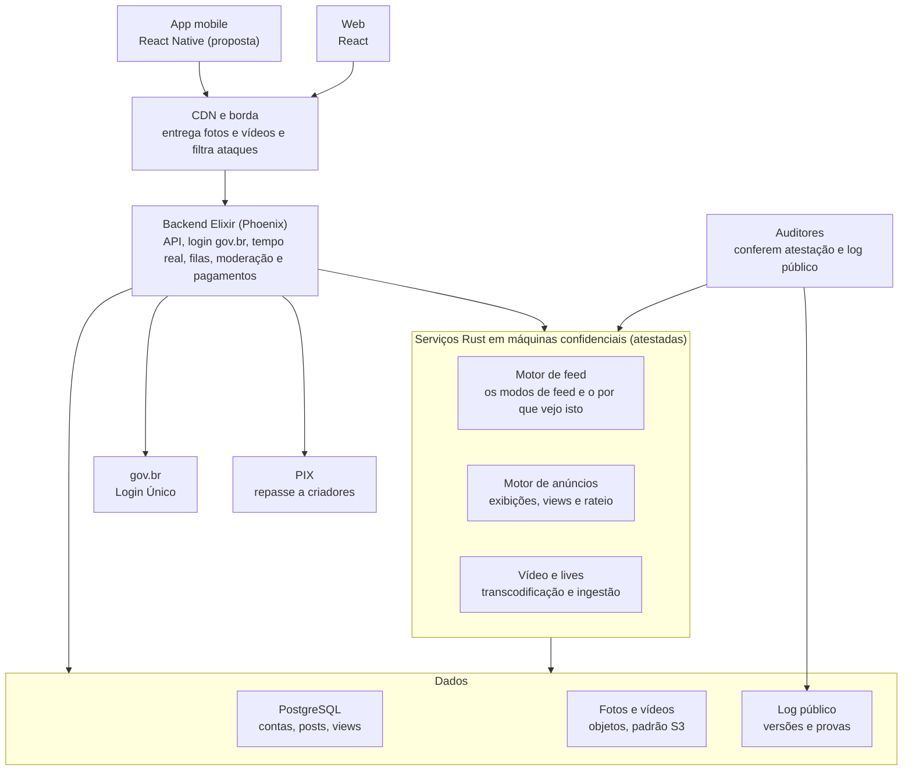

# Plano inicial -rede+social

Versão de 7 de outubro de 2026. Daqui em diante, mudanças nas regras descritas aqui passam por [RFC](rfcs/README.md).

A -rede+social é uma rede social pública, de código aberto e sem fins lucrativos, com infraestrutura paga pelo governo. Este plano define produto, dinheiro, algoritmos, arquitetura, segurança, governança e as fases até um piloto com o governo. O texto para o público está no [manifesto](../MANIFESTO.md).

## 1. Princípios

Toda decisão de produto, código ou negócio precisa respeitar estas seis regras. Se uma proposta quebra alguma, ela não entra.

1. **Pública e sem dono.** O governo paga a infraestrutura, mas não controla conteúdo nem algoritmo.
2. **Sem fins lucrativos.** A receita paga criadores e infraestrutura. Não existe lucro a distribuir.
3. **Dados não são produto.** Nenhum dado pessoal é vendido ou compartilhado com anunciantes. A segmentação de anúncios usa só a região aproximada e o contexto do vídeo.
4. **Transparência verificável.** O código é aberto, e qualquer pessoa consegue provar que o código em produção é o publicado.
5. **Escolha do usuário.** O usuário escolhe o modo do feed e entende por que cada post apareceu.
6. **Segurança pelo desenho.** A segurança não depende de código secreto, só de chaves e dados protegidos.

## 2. Produto

A rede tem três módulos sob um perfil único. Só o módulo de vídeo tem anúncios, e é ele que sustenta os criadores.

| Módulo | O que faz | Interações | Anúncios |
| --- | --- | --- | --- |
| Fotos e feed | Posts com uma ou mais fotos e legenda; grade no perfil | Curtir, comentar, salvar (proposta) | Não (proposta) |
| Texto curto | Frases rápidas com limite de caracteres (proposta: 140) | Curtir e repostar; sem respostas | Não |
| Vídeos | Vídeos gravados de qualquer duração | Curtir, comentar, salvar | Nos pontos que o criador marcar |
| Shorts | Vídeos verticais curtos em sequência | Curtir, comentar, salvar | 1 anúncio a cada 6 shorts |
| Lives | Transmissão ao vivo, com gravação opcional | Chat ao vivo (proposta) | A definir |

Requisitos que valem para todos os módulos:

- **Celular primeiro.** A maioria dos brasileiros acessa a internet pelo celular, então o app precisa funcionar bem em aparelhos simples.
- **Internet fraca.** Vídeo com qualidade adaptativa, upload que retoma de onde parou e modo econômico de dados.
- **Acessibilidade.** Texto alternativo em fotos, legendas automáticas em vídeos e compatibilidade com leitores de tela.
- **Fora da primeira versão:** mensagens diretas, grupos e loja.

## 3. Contas e acesso

O login pelo gov.br garante uma pessoa real por conta. A rede guarda o mínimo possível sobre quem é essa pessoa.

| Tipo de conta | Como entra | O que pode fazer |
| --- | --- | --- |
| Visitante | Sem login | Ver posts públicos abertos por link |
| Conta básica | E-mail ou telefone, sem gov.br | Ver o feed, seguir e salvar. Não publica, não comenta, não monetiza |
| Conta verificada | gov.br, qualquer nível | Tudo nos três módulos, inclusive lives |
| Criador monetizado | gov.br prata ou ouro + chave PIX no próprio CPF ou CNPJ | Receber por anúncios |
| Anunciante | gov.br da empresa (CNPJ) | Comprar campanhas nacionais ou regionais |

Como a identidade fica protegida:

- **Sem CPF guardado em texto.** A rede guarda só uma impressão digital do CPF, gerada com uma chave secreta. Ela serve para impedir contas duplicadas. Além dela, existe só uma cópia cifrada do CPF, usada exclusivamente para ordens judiciais (veja abaixo).
- **Só o necessário.** Do gov.br vem apenas o identificador, a faixa de idade e o nível da conta. Como o perfil usa apelido, o nome real não é lido nem guardado.
- **O governo não vê o que você posta.** O gov.br só fica sabendo que houve um login. Pedidos de dados por autoridades exigem ordem judicial, e o total de pedidos sai no relatório de transparência.
- **Menores de idade.** Perfil privado por padrão e sem anúncios, conforme a legislação de proteção de crianças e adolescentes on-line.

Decidido: o perfil público usa apelido, com um selo que mostra que a conta é de uma pessoa verificada. O nome real do gov.br não aparece para ninguém na rede.

### Identificação por ordem judicial

A lei obriga a rede a identificar um usuário quando um juiz manda. Ao mesmo tempo, ninguém dentro da rede deveria conseguir descobrir sozinho quem está por trás de um apelido. Para conciliar as duas coisas, o CPF fica numa cópia cifrada que só um grupo de guardiões independentes consegue abrir, e uma conta de cada vez.

1. No cadastro, o CPF é cifrado com uma chave cuja parte secreta foi dividida em 5 pedaços, um para cada guardião. Cada pedaço fica num cofre de hardware (HSM) da própria instituição.
2. Quando chega uma ordem judicial, a entidade gestora encaminha a ordem aos guardiões, e cada um confere por conta própria se ela é válida antes de participar.
3. Com 3 dos 5 pedaços, os guardiões abrem só o CPF daquela conta. A chave inteira nunca é montada num lugar só, então abrir uma conta não dá acesso às outras.
4. Cada abertura entra no log público com a data e o órgão que mandou, sem identificar a pessoa. Se o processo for sigiloso, ela aparece só na contagem do relatório de transparência.

A regra é 3 de 5, e não todos, porque a rede não pode ficar impedida de cumprir a lei se um guardião perder a chave ou deixar de existir. A proposta de guardiões é a entidade gestora, uma universidade pública, uma organização da sociedade civil, um órgão de controle e o conselho multissetorial, mas a composição ainda está em aberto.

Os registros de acesso (IP, data e hora) ficam guardados pelos seis meses que o Marco Civil exige, cifrados do mesmo jeito.

## 4. Algoritmos de feed

O usuário escolhe entre quatro modos e troca quando quiser. Todos são públicos, determinísticos e auditáveis: com os mesmos dados e a mesma versão, o resultado é sempre o mesmo.

| Modo | O que entra no feed | Como ordena |
| --- | --- | --- |
| Na bolha | Quem você segue e seus temas de interesse | Afinidade, recência e qualidade |
| Furando a bolha | Conteúdo bem avaliado de temas e regiões longe do seu perfil | Diversidade, com filtro mínimo de qualidade |
| Meio a meio | Os dois modos acima intercalados | Proposta: 50% cada, com ajuste fino numa versão futura |
| Sem algoritmo: data | Só quem você segue | Do mais novo para o mais antigo |
| Sem algoritmo: ranking | Todo o conteúdo público | Uma fórmula pública, igual para todos |

Regras que valem para todos os modos:

- **Parâmetros abertos.** Pesos e janelas de tempo ficam num arquivo público e versionado. Mudar um peso é uma mudança de código como qualquer outra.
- **Por que estou vendo isto.** Cada item mostra os sinais que o colocaram ali, como "você segue", "tema: futebol" ou "furando a bolha: região Norte".
- **Perfil de interesses visível.** O usuário vê e edita os temas que a rede acha que ele gosta.
- **Dados sensíveis fora.** Posição política, religião, raça e saúde nunca são inferidas nem usadas para ranquear.
- **Sem impulsionamento pago.** Não dá para pagar para aparecer mais no feed. Contas de governo, partidos e políticos seguem as mesmas regras de todos.
- **Modo padrão** para quem acabou de chegar: a decidir (proposta: meio a meio).

## 5. Moderação

Numa rede paga pelo Estado, o medo natural é a moderação virar censura. Por isso toda remoção precisa ter motivo escrito, poder ser contestada e aparecer nos relatórios públicos.

- **Regras curtas e públicas.** A rede remove o que a lei manda remover e pouco mais. Cada regra tem número, texto simples e exemplos.
- **Três camadas.** Filtro automático só para conteúdo claramente ilegal, como material de abuso infantil. Denúncias de usuários entram numa fila. Revisão humana decide o resto.
- **Toda remoção cita a regra.** O autor é avisado, vê o motivo e pode recorrer. O recurso é julgado por outra equipe.
- **Pedidos externos só por canal formal.** Ministério, partido ou político não pedem remoção por fora. Pedidos judiciais são cumpridos e contados no relatório.
- **Relatório trimestral.** Remoções por regra, recursos aceitos e pedidos de autoridades, com base legal.
- **Conselho de conteúdo independente.** Julga casos difíceis e revisa as regras uma vez por ano.
- **Eleições.** Sem propaganda política paga em nenhum período, e cumprimento das regras do TSE.

Revisão jurídica necessária antes do piloto: Marco Civil da Internet (com a decisão do STF de 2025 sobre o artigo 19), LGPD, ECA Digital e resoluções do TSE.

## 6. Monetização

Só vídeos e shorts têm anúncio. O criador decide se quer anúncio, e toda a divisão do dinheiro segue regras públicas.

### Onde os anúncios aparecem

- **Vídeos:** o criador marca os pontos de anúncio (início, meio ou fim). Sem marcação, não tem anúncio nem receita.
- **Shorts:** um anúncio a cada 6 shorts assistidos. A receita é dividida entre os criadores desses 6 shorts, proporcional ao tempo assistido de cada um (proposta). Quem desligou anúncios não entra no rateio.
- **Lives:** a definir.

### Anúncio nacional

- A empresa compra horas de exibição por dia. Exemplo: 10.000 horas por dia de um anúncio de 30 segundos equivalem a 1,2 milhão de exibições.
- O motor de anúncios espalha essas exibições ao longo do dia e pelo país, proporcional à audiência de cada região.
- O criador recebe por view, e o valor cai por faixas conforme ele cresce. A faixa vale só para as views dentro dela, como no imposto de renda. Assim, crescer nunca diminui o ganho total.

| Views do criador no mês | Valor por view (% do valor base) |
| --- | --- |
| Até 100 mil | 100% |
| De 100 mil a 1 milhão | 75% |
| De 1 milhão a 10 milhões | 50% |
| Acima de 10 milhões | 30% |

Os valores da tabela são ilustrativos. Exemplo: com 2 milhões de views no mês, o criador recebe o equivalente a 1,275 milhão de views no valor base. Decisão em aberto: a diferença vai para o fundo de infraestrutura ou para um bônus de criadores pequenos.

### Anúncio regional

- Comprado por município ou estado. Custa menos por exibição e paga menos ao criador.
- Aparece só para quem assiste daquela região, de preferência nos vídeos de criadores grandes, onde há audiência local suficiente. É assim que a padaria do bairro alcança muita gente.
- A região do espectador é aproximada (pela conexão ou pelo município informado). Localização precisa nunca é usada.

### Divisão e pagamento

- A receita de cada anúncio se divide entre criador e fundo de infraestrutura. A proporção está em aberto.
- O fechamento é mensal, com repasse por PIX para a chave no CPF ou CNPJ do criador.
- Cada criador tem um extrato aberto: views por vídeo, faixa aplicada e rateio dos shorts. O cálculo pode ser verificado por qualquer pessoa (seção 9).

### Regras para anunciantes

- **Biblioteca pública de anúncios:** anunciante, região, período e valor pago de cada campanha.
- **Proibido:** propaganda política ou eleitoral. Apostas e governo anunciando a própria gestão são decisões em aberto (proposta: proibir os dois e permitir só campanhas de utilidade pública).
- **Antifraude:** só conta view de conta logada com tempo mínimo assistido. Como cada conta é uma pessoa, fica bem mais difícil usar bots.

## 7. Arquitetura

O backend em Elixir atende o app e a web e orquestra tudo. O que precisa ser auditado (feed e anúncios) e o processamento pesado de vídeo rodam em Rust, em máquinas cuja atestação qualquer auditor confere contra o log público.

- **Elixir e Rust conversam por gRPC**, como serviços separados. Uma falha em Rust não derruba o backend.
- **PostgreSQL** com as tabelas grandes (posts e views) particionadas por mês e réplicas de leitura para o feed.
- **Filas com Oban**, que roda sobre o próprio PostgreSQL e evita mais um sistema para operar.
- **Vídeo** em várias resoluções, entregue por HLS, com codecs eficientes para economizar banda.
- **Hospedagem** em nuvem de governo ou em data centers próprios: decisão em aberto.

## 8. Segurança com código aberto

Com o código aberto, o atacante conhece o sistema tão bem quanto a equipe. Então a segurança tem que vir de chaves bem guardadas, de ninguém ter poder sozinho e de muita gente revisando o código, e não de esconder como o sistema funciona.

| Ameaça | Controle |
| --- | --- |
| Roubo de conta | Login gov.br com dois fatores, sessões curtas e tokens presos ao aparelho |
| Vazamento do banco | Criptografia em repouso, CPF guardado só como impressão digital e numa cópia cifrada que nenhuma pessoa abre sozinha, campos sensíveis cifrados |
| Administrador mal-intencionado ou pressionado | Ninguém acessa produção sozinho: toda ação exige duas pessoas e vai para um log público que não pode ser alterado |
| Código malicioso numa contribuição ou dependência | Revisão por dois mantenedores, dependências fixadas com lista pública (SBOM), builds reproduzíveis e assinados |
| Bots e spam | Uma pessoa por conta, limites de uso por conta e por rede, antifraude de views |
| Ataque de negação de serviço | CDN com filtragem na borda e operação em mais de um data center |
| Falha ainda desconhecida | Recompensa pública por falhas (bug bounty), política de divulgação responsável e auditoria externa antes de cada fase |
| Segredo vazado no repositório | Varredura automática de segredos em cada commit; chaves só em cofre, nunca em arquivo |

A configuração dos servidores também é código público. Só ficam fora as chaves e os dados das pessoas. Para a LGPD, o projeto nomeia um encarregado de dados e publica o relatório de impacto à proteção de dados antes do piloto.

## 9. Auditabilidade

Qualquer pessoa precisa conseguir provar três coisas: que o código em produção é o publicado, que os dados de entrada não foram trocados depois e que os pagamentos seguiram a fórmula. Nenhuma tecnologia faz isso sozinha. O plano junta seis peças:

| Peça | Tecnologia | O que prova |
| --- | --- | --- |
| Build reproduzível | Nix | O binário publicado sai exatamente do código-fonte, com o mesmo hash para quem compilar |
| Assinatura e log público | Sigstore (cosign e Rekor) | Quais versões existem e quando foram publicadas; o log só aceita acréscimos |
| Atestação remota | Máquinas confidenciais com AMD SEV-SNP ou Intel TDX | Qual binário está rodando agora em cada servidor, assinado pelo próprio processador |
| Verificador aberto | Ferramenta de linha de comando + página pública de atestações | Qualquer pessoa compara a atestação com o log, sem pedir licença |
| Compromisso dos dados | Raiz Merkle diária dos sinais de ranking e das views, publicada no log | Que os dados usados no feed e nos pagamentos não foram alterados depois |
| Provas de pagamento | zkVM (RISC Zero ou SP1) | Que o rateio mensal de anúncios seguiu a fórmula publicada |

O modelo de referência é o Private Cloud Compute da Apple, que publica as imagens dos servidores num log e deixa pesquisadores conferirem a atestação.

Limites assumidos:

- **Confiança no fabricante do chip.** A atestação depende de AMD ou Intel. Mitigação: usar os dois fornecedores e ter verificadores independentes.
- **Código não prova intenção sobre dados.** Por isso os compromissos diários e a ferramenta que refaz o cálculo do feed de um usuário a partir dos dados comprometidos.
- **Provas criptográficas custam caro.** Elas ficam para os pagamentos mensais. O feed em tempo real usa atestação e reexecução por amostragem.

## 10. Governança

Quem decide os rumos da rede é um conselho com representantes de vários setores, e não o governo que paga a conta. Os mandatos desse conselho não coincidem com o do presidente, para que nenhum governo consiga tomar conta da rede.

- **Entidade gestora.** Forma jurídica em aberto: fundação pública, organização social com contrato de gestão ou associação civil. O que importa é autonomia, orçamento plurianual e prestação de contas pública.
- **Conselho multissetorial.** Governo, sociedade civil, academia, criadores e setor privado, inspirado no modelo do CGI.br. Nenhum setor tem maioria sozinho.
- **Como uma regra muda.** Proposta pública no repositório, 30 dias de comentários (proposta), decisão do conselho e registro no log antes de entrar no ar. Correções urgentes de segurança entram antes e são explicadas depois.
- **Licença.** Proposta: AGPL-3.0. Quem rodar uma versão modificada como serviço é obrigado a publicar o código.
- **Comunidade.** Repositório público, contribuições abertas, código de conduta e reuniões técnicas com ata pública.
- **Contas abertas.** Custos mensais de infraestrutura, receita de anúncios e repasses publicados todo mês.
- **Continuidade.** Exportação completa dos dados de cada usuário desde o início. Numa fase futura, interoperabilidade com protocolos abertos como o ActivityPub, para a rede sobreviver mesmo se um governo quiser desligá-la.

## 11. Roadmap

Cada fase só começa quando a anterior passa no portão, que é o critério objetivo para seguir em frente. As fases ainda não têm datas: o ritmo depende de quantas pessoas contribuírem.

1. **Fase 0 · Manifesto e comunidade.** Manifesto publicado, repositório aberto, licença e regras de contribuição. Primeiros contribuidores e conselho provisório.
    - Portão: as 3 decisões que travam a Fase 1 estão fechadas.
2. **Fase 1 · Protótipo.** Texto curto e fotos, login gov.br em ambiente de teste, feed por data. React, Elixir e PostgreSQL funcionando de ponta a ponta.
    - Portão: um grupo de teste usa o protótipo sem ajuda da equipe.
3. **Fase 2 · Algoritmos e transparência.** Os modos de feed em Rust, "por que vejo isto" e perfil de interesses editável. Builds reproduzíveis, log público e verificador aberto.
    - Portão: alguém de fora reproduz o build e confere o cálculo do feed.
4. **Fase 3 · Vídeo.** Vídeos, shorts e lives, com transcodificação em Rust e entrega por CDN.
    - Portão: custo por hora de vídeo medido e dentro do orçamento.
5. **Fase 4 · Anúncios e pagamentos.** Anúncios nacionais e regionais, faixas decrescentes, repasse por PIX. Extrato aberto do criador e provas mensais de pagamento.
    - Portão: auditoria externa de segurança e de pagamentos e revisão jurídica aprovadas.
6. **Fase 5 · Piloto com o governo.** Atestação em produção, entidade gestora e conselho formados. Piloto público com orçamento definido e primeiro relatório de transparência.

## 12. Riscos

O risco mais sério é a rede passar a ser vista como ferramenta do governo do momento, porque aí ela perde a razão de existir. A tabela está em ordem de gravidade.

| Risco | O que acontece | Mitigação |
| --- | --- | --- |
| Captura política | Perda total de confiança | Conselho com mandatos descasados, algoritmo verificável, moderação contestável e relatórios públicos |
| Desligamento por troca de governo | A rede some com o conteúdo de todos | Base legal, orçamento plurianual, exportação de dados e código que outros podem operar |
| Medo de vigilância pelo gov.br | Pessoas evitam se cadastrar | CPF aberto só por ordem judicial e com 3 de 5 guardiões, dados mínimos, auditoria externa |
| Custo de vídeo | Orçamento estoura | Limites de upload por conta, codecs eficientes, cache nos pontos de troca de tráfego (IX.br), parte dos anúncios para o fundo |
| Pouca adesão | Rede vazia, criadores não migram | Começar por quem ganha mais aqui: criadores pequenos e comércio local; importação de conteúdo de outras redes |
| Insegurança jurídica | Processos e remoções forçadas | Revisão jurídica antes do piloto, regras claras, canal formal para pedidos |
| Fraude de views | Pagamentos injustos | Uma pessoa por conta, tempo mínimo assistido, auditoria de padrões, provas de pagamento |
| Falha explorada no código aberto | Vazamento de dados | Bug bounty, auditorias por fase, defesa em camadas |
| Dependência de chips estrangeiros | Atestação com confiança limitada | Dois fornecedores e verificadores independentes |

## 13. Decisões em aberto

As três primeiras travam a Fase 1. As outras podem esperar até a fase em que entram.

- [x] Perfil público: apelido com selo de verificado (decidido)
- [ ] Limite de caracteres do texto curto (proposta: 140)
- [ ] Licença do código (proposta: AGPL-3.0)
- [ ] Interações no texto curto: curtir e repostar bastam?
- [ ] Modo padrão do feed para quem acabou de chegar (proposta: meio a meio)
- [ ] App mobile em React Native ou como aplicativo web instalável
- [ ] Rateio dos shorts por tempo assistido ou em partes iguais
- [ ] Anúncios em lives
- [ ] Faixas e percentuais do pagamento decrescente
- [ ] Destino da diferença das faixas: fundo de infraestrutura ou bônus para criadores pequenos
- [ ] Proporção da receita entre criador e fundo de infraestrutura
- [ ] Anúncio regional por município ou por estado
- [ ] Apostas e publicidade de governo como anunciantes
- [ ] Forma jurídica da entidade gestora
- [ ] Hospedagem: nuvem de governo (Serpro, Dataprev) ou data centers próprios
- [ ] Quem são os 5 guardiões da cópia cifrada do CPF
